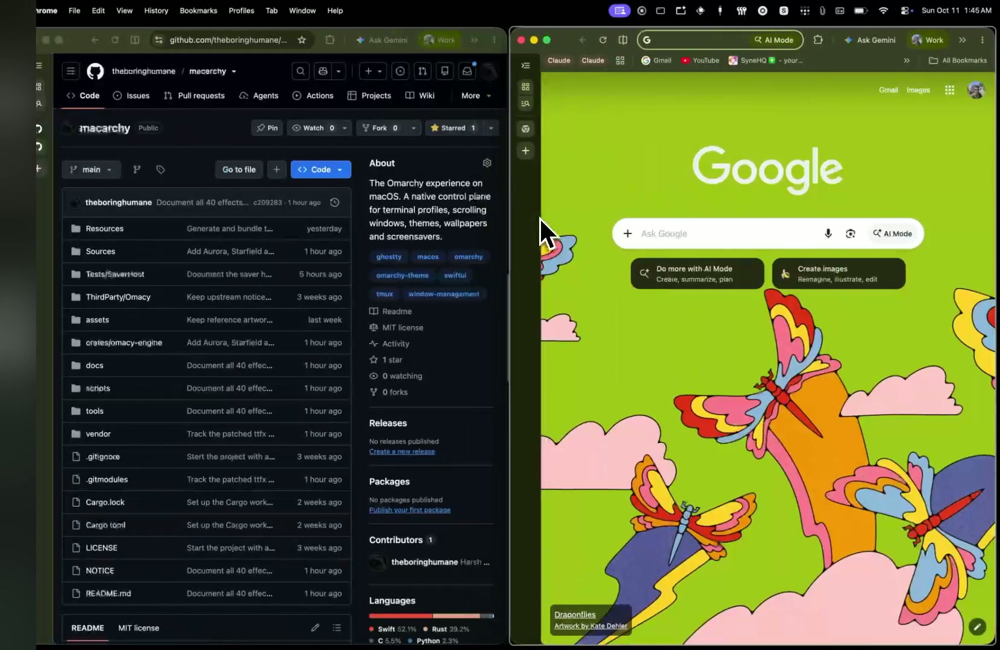
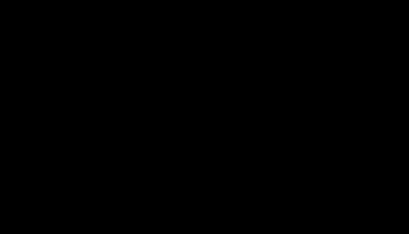

# Macoma

The Omarchy experience, on macOS. Previously called Macarchy. Macoma is a native control plane for your desktop: coordinated colors, a terminal workspace, scrolling window columns, wallpapers and animated screensavers. Keep your Mac, your apps and your existing setup.

Apple Silicon · macOS 15 or later · SwiftUI, AppKit, Metal and Rust

On macOS 26, the app uses native Liquid Glass navigation, toolbars and controls. macOS 15 uses the standard native appearance. No new OS, disk partitioning, SIP changes or replacement window server is involved.

## Window management demo

[](docs/demos/window-management.mp4)

[Watch the 24-second demo](docs/demos/window-management.mp4). An early recording from before the Macoma rename: windows arrange into columns and move across the desktop. WhatsApp content and private terminal output are blurred; audio is removed. [Recording notes](docs/demos/README.md).

## Your desktop, in one place

| Module | What it does |
| --- | --- |
| **Appearance** | 23 Omarchy palettes, a catalog of 96 wallpaper entries, custom image import, Apply and Restore. |
| **Terminal** | A separate native Ghostty profile with the selected palette, fonts and an optional three-pane tmux Work session. |
| **Windows** | Horizontally scrolling columns, vertical stacks, gaps, keyboard rearrangement and a focused-window border. Experimental; one display/current Space. |
| **Screensavers** | 40 effects, custom text/PNG/SVG artwork, live preview and a real macOS system screensaver. |

The Overview brings these modules together. A menu-bar menu keeps navigation and Pause available when the main window is closed. Choose a palette in Appearance, apply it to your terminal profile, and use it for the window focus border. Each module has explicit controls; opening Macoma does not rearrange windows, install packages or replace shell dotfiles.

### Terminal

Omarchy currently defaults to **Foot**, which depends on Wayland. Macoma brings the workflow to native **Ghostty**. Install Ghostty separately, open **Terminal**, choose a font, then select **Apply Profile** and launch a terminal or **Work Session**.

Work uses a dedicated `tmux -L macarchy` server: one wide upper pane and two lower panes, with the status bar at the top. Reopening Work attaches to its existing panes. **Command-T** opens an adaptive split in a managed terminal; inside Work it creates a tmux pane. **Command-Shift-T** remains available for a native tab. These are terminal panes inside one Ghostty window; the Windows module arranges separate application windows.

Managed profiles live under `~/.config/macarchy/terminal`. Each applied generation is preserved for restoration. Your normal Ghostty configuration, shell dotfiles and other tmux servers are retained. Optional shell tools are detected and explained in the app; Macoma does not install them automatically.

### Scrolling windows

Enable window management from **Windows** after allowing Macoma in macOS Accessibility. New windows get columns; moving focus reveals columns beyond the viewport. You can stack windows, adjust column widths and reorder them using the app or its shortcuts. **Pause** restores saved positions, and quitting attempts restoration too.

This is an experimental public-API implementation for **one display and the current native Space**. macOS cannot clip other apps into a custom viewport: overflow keeps a visible edge, and some apps clamp their size or position. The UI reports those cases. Space/display changes and sleep pause management. Multiple monitors, trackpad scrolling, compositor effects, native Space control and crash recovery are not implemented. Original frames are retained only for the running app session. Hidden, minimized or other-Space windows wait for restoration until they become visible again. See [window qualification](Tests/Windows/VALIDATION.md).

### Palettes and wallpapers

The catalog references a pinned Omarchy revision. Select **Load Previews** or an individual wallpaper to download images on demand. You can also import your own image. Apply uses connected displays; Restore keeps a recovery journal across app launches and protects changes made outside Macoma.

The repository includes palette definitions and wallpaper metadata, not a rehosted wallpaper pack. The 96 entries can include the same artwork in different themes. Per-image redistribution rights have not been established; source links and hashes are preserved in the [source notes](ThirdParty/Omarchy/README.md). Native wallpaper behavior across multiple Spaces is not qualified.

## Use the local build

Open `build/Macoma.app` to use the control plane. In **Screensavers**, select an effect to preview it. Check the effects you want in the random rotation, or choose **Use Only [effect]** in the inspector to repeat the selected effect. **Edit Artwork…** accepts text, PNG and SVG files. **Apply Changes** saves your artwork and settings.

Choose **Install Screensaver**, then select **Macoma** in System Settings → Wallpaper → Screen Saver on macOS 26, or System Settings → Screen Saver on macOS 15. The installer writes only to your user's `Library/Screen Savers` folder and preserves an existing Macoma bundle in `Library/Application Support/Macarchy/Backups`. It does not change the system's password or lock-screen policy. Use the **Screensaver → Install Screensaver…** menu to replace an installed version after rebuilding.

Choose **Full Screen** in the controls below the preview or use the **Screensaver** menu. The full-screen preview exits on any key or click. It previews the selected effect; your system screensaver uses the saved rotation.

## Build

Requires Git, Xcode 26 with the macOS 26 SDK, Python 3, and Rust/Cargo. Swift sources use Swift 5 language mode on the current Swift toolchain. Liquid Glass APIs are availability-gated so the built app also runs on macOS 15. No package-manager installation or third-party updater is required.

```sh
git clone --recurse-submodules https://github.com/theboringhumane/macoma.git
cd macoma
python3 scripts/build.py
open build/Macoma.app
```

For an existing checkout, run `git submodule update --init --recursive` before building or running Cargo commands. GitHub source ZIPs omit submodule contents; use a recursive clone to build from source.

`vendor/ttfx` is a submodule of [the native bridge fork](https://github.com/theboringhumane/ttfx/tree/macarchy-native-bridge), pinned to an exact commit based on upstream v0.3.2. That commit includes the existing Omacy bridge patch, so no manual patch step is needed. The upstream pin and patch provenance remain in [`vendor/ttfx.PIN`](vendor/ttfx.PIN) and [`vendor/patches/ttfx-omacy.patch`](vendor/patches/ttfx-omacy.patch). Use `git submodule update --init --recursive` to restore the recorded revision; `--remote` instead follows the fork branch and can select an unqualified revision.

The native bridge retains the previously qualified v0.3.2 engine. Moving to a newer upstream revision requires reconciling the bridge patch and requalifying the native renderer and all effects.

The build produces self-contained `build/Macoma.app` and `build/Macoma.saver` bundles. The app embeds the saver. Metal shaders are compiled by the system at runtime and cached in the process, so the optional Xcode Metal command-line toolchain is not required.

Both artifacts target arm64 and declare macOS 15 as the minimum; current runtime qualification is on macOS 26.5.2. Local and automated release builds are ad-hoc signed unless a trusted Developer ID identity is configured. Ad-hoc signing is not notarization, and Gatekeeper may block downloaded builds.

### Quick install

On Apple Silicon, install the latest GitHub release with:

```sh
curl -fsSL https://raw.githubusercontent.com/theboringhumane/macoma/main/setup.sh | bash
```

The script downloads the release DMG and its SHA-256 file, verifies the checksum and bundle signatures, then installs the app and screensaver for the current user. Existing Macoma bundles are kept in `~/Library/Application Support/Macarchy/Backups`. It does not use `sudo` or change lock-screen settings. Ad-hoc signed downloads may still be blocked by Gatekeeper; a self-signed certificate does not establish public trust. Normal Gatekeeper distribution requires a Developer ID certificate and Apple notarization.

Each `v*` tag builds the app, runs the packaged screensaver host check, creates the DMG and checksum, then attaches both to that GitHub release. The workflow can also be run manually for an existing release tag.

To install both bundles for the current user:

```sh
python3 scripts/install.py
open ~/Applications/Macoma.app
```

After Swift-only changes, `python3 scripts/build.py --skip-engine` reuses the existing Rust release library. Builds use fresh staging bundles and retain the immediately preceding successful artifacts as `.previous` directories.

## Upgrading from Macarchy

The app is now **Macoma.app**. The installer retains the previous app in its backup folder. Existing `~/.config/macarchy` files, Application Support data, bundle identifiers and tmux socket remain stable, so saved artwork, profiles and restoration receipts keep working. An already-installed `Macarchy.saver` is updated in place with the Macoma display name to preserve the system's selected module path; fresh installs use `Macoma.saver`.

macOS may require a new Accessibility grant after replacing or renaming an ad-hoc signed app. If Windows cannot enable, allow the installed **Macoma.app** in System Settings → Privacy & Security → Accessibility, then enable it again.

## Screensaver configuration

The Screensavers module writes `~/.config/macarchy/settings.json` and `~/.config/macarchy/screensaver.txt`. The saver reloads them at effect boundaries. Malformed input falls back to the last valid configuration. A copy saved through Apple's `ScreenSaverDefaults` API is available to hosts that cannot read the public files.

Text art supports UTF-8 block and Braille characters, up to 256 columns, 128 lines and 64 KiB. PNG/SVG import converts to an 80×26 grid with block/Braille, threshold and invert controls. The app supports a saved background color and text size. Effects use their per-effect color palettes.

The engine steps at 60 Hz. App and system saver displays present at 30 FPS. The display link controls full-screen presentation. This follows the native bridge's timing policy; it does not claim identical duration or pixels to Omarchy's 120 FPS terminal loop.

Each display rotates independently. macOS can create several preview and full-screen contexts in one host process; those contexts never wait on a shared display barrier.

## Verification

```sh
bash Tests/Appearance/run.sh --network
bash Tests/Terminal/run.sh
sh Tests/Windows/run-model-tests.sh
./scripts/test-engine.sh
Tests/SaverHost/run.sh --bundle build/Macoma.saver --output build/evidence/saver-host
```

The [control-plane qualification](docs/build-qualification.md) records module tests, native terminal launch, wallpaper apply/restore, the user-observed basic scrolling workflow, and build 6 confirmations for Command-T panes and smooth mouse drag/resize. Windows remains experimental; the report lists what has not been qualified.

The engine suite exercises all 40 effects to completion through the native grid and actual main-thread C ABI, repeated random transitions, conversion, errors and ABI compatibility. The saver harness loads the packaged `NSPrincipalClass`, captures moving previews, and verifies stop, resize, detach, sleep/wake notifications and deallocation. Add `--visible` to the saver harness for its brief visible Metal host check.

The [screensaver build 4 qualification](docs/evidence/build-0.2.0-4.json) records 74 passing Rust tests, all 40 native C ABI effect cycles, packaged AppKit/Metal host checks, and verified build and installed identities for v0.2.0.

The [submodule qualification](docs/evidence/ttfx-submodule-2026-10-11.json) records a fresh checkout, public dependency initialization, all 65 Rust tests and 37 C ABI effect cycles, and a complete signed native build. The pinned dependency matches all 147 files of the previous engine snapshot.

Automatic idle activation was also verified on macOS 26.5.2: after 60 seconds of inactivity, macOS launched the installed build 3 through its system screensaver host. See [engine qualification](docs/engine-qualification.md), [build qualification](docs/build-qualification.md), and the earlier [portability audit](docs/screensaver-audit.md) for evidence and limits. Physical external-monitor behavior remains unqualified.

## Source layout

- `Sources/App`: app lifecycle, control-plane navigation and shared palette selection.
- `Sources/Modules/Appearance`: palettes, wallpaper downloads, import and restoration.
- `Sources/Modules/Terminal`: isolated Ghostty profiles and tmux workspace setup.
- `Sources/Modules/Windows`: scrolling layout, public Accessibility integration and shortcuts.
- `Sources/Modules/Screensavers/Companion`: effect browser, artwork editor, preview and installer.
- `Sources/Modules/Screensavers/Extension`: the system `ScreenSaverView` bundle.
- `Sources/Modules/Screensavers/Shared`: engine bridge, Metal renderer and configuration.
- `crates/omacy-engine`: Rust bridge, Macoma original effects, conversion and engine tests.
- `vendor/ttfx`: submodule pinned to the v0.3.2 engine with the existing native bridge patch.
- `Resources`: module catalogs/templates, original Macoma artwork/icon and licensed Fairfax HD font.
- `Tests`: module checks and the packaged native screensaver host.
- `ThirdParty`: pinned source provenance and licenses.

See [architecture](docs/architecture.md) for module boundaries and [Omarchy mapping](docs/omarchy-mapping.md) for source references and future candidates.

## Screensaver gallery

### Macoma originals

Three original effects built for Macoma. Each cycle uses a seed to vary its motion while keeping your artwork readable at the end. These previews come from the native engine with the bundled Fairfax HD font.

| Aurora | Starfield |
|:---:|:---:|
| <br>Flowing light curtains shimmer across the canvas and reveal your artwork. | <br>Stars travel outward through a field of terminal glyphs before your artwork settles into view. |
| **Circuit** | |
| <br>Glowing paths take right-angle turns across the grid and trace your artwork into place. | |

### ttfx effects

All 37 effects below are included. These original upstream GIFs show the Omarchy wordmark in a terminal; Macoma renders your chosen artwork through its native grid, so font sizing and timing can differ. Some upstream previews shorten timed phases for the gallery. Animation credit: [TerminalTextEffects](https://github.com/ChrisBuilds/terminaltexteffects) by ChrisBuilds, ported to Rust by [ttfx](https://github.com/omacom/ttfx).

|     |     |
|:---:|:---:|
| <b>beams</b><br><br><sub>Create beams which travel over the canvas illuminating the characters behind them</sub> | <b>binarypath</b><br><br><sub>Binary representations of each character move towards the home coordinate of the character</sub> |
| <b>blackhole</b><br><br><sub>Characters are consumed by a black hole and explode outwards</sub> | <b>bouncyballs</b><br><br><sub>Characters are bouncy balls falling from the top of the canvas</sub> |
| <b>bubbles</b><br><br><sub>Characters are formed into bubbles that float down and pop</sub> | <b>burn</b><br><br><sub>Burns vertically in the canvas</sub> |
| <b>colorshift</b><br><br><sub>Display a gradient that shifts colors across the terminal</sub> | <b>crumble</b><br><br><sub>Characters lose color and crumble into dust, vacuumed up, and reformed</sub> |
| <b>decrypt</b><br><br><sub>Display a movie style decryption effect</sub> | <b>errorcorrect</b><br><br><sub>Some characters start in the wrong position and are corrected in sequence</sub> |
| <b>expand</b><br><br><sub>Expands the text from a single point</sub> | <b>fireworks</b><br><br><sub>Characters launch and explode like fireworks and fall into place</sub> |
| <b>highlight</b><br><br><sub>Run a specular highlight across the text</sub> | <b>laseretch</b><br><br><sub>A laser etches characters onto the terminal</sub> |
| <b>matrix</b><br><br><sub>Matrix digital rain effect</sub> | <b>middleout</b><br><br><sub>Text expands in a single row or column in the middle of the canvas then out</sub> |
| <b>orbittingvolley</b><br><br><sub>Four launchers orbit the canvas firing volleys of characters inward to build the input text from the center out</sub> | <b>overflow</b><br><br><sub>Input text overflows and scrolls the terminal in a random order until eventually appearing ordered</sub> |
| <b>pour</b><br><br><sub>Pours the characters into position from the given direction</sub> | <b>print</b><br><br><sub>Lines are printed one at a time following a print head. Print head performs line feed, carriage return</sub> |
| <b>rain</b><br><br><sub>Rain characters from the top of the canvas</sub> | <b>randomsequence</b><br><br><sub>Prints the input data in a random sequence</sub> |
| <b>rings</b><br><br><sub>Characters are dispersed and form into spinning rings</sub> | <b>scattered</b><br><br><sub>Text is scattered across the canvas and moves into position</sub> |
| <b>slice</b><br><br><sub>Slices the input in half and slides it into place from opposite directions</sub> | <b>slide</b><br><br><sub>Slide characters into view from outside the terminal</sub> |
| <b>smoke</b><br><br><sub>Smoke floods the canvas colorizing any characters it crosses</sub> | <b>spotlights</b><br><br><sub>Spotlights search the text area, illuminating characters, before converging in the center and expanding</sub> |
| <b>spray</b><br><br><sub>Draws the characters spawning at varying rates from a single point</sub> | <b>swarm</b><br><br><sub>Characters are grouped into swarms and move around the terminal before settling into position</sub> |
| <b>sweep</b><br><br><sub>Sweep across the canvas to reveal uncolored text, reverse sweep to color the text</sub> | <b>synthgrid</b><br><br><sub>Create a grid which fills with characters dissolving into the final text</sub> |
| <b>thunderstorm</b><br><br><sub>Create a thunderstorm in the terminal</sub> | <b>unstable</b><br><br><sub>Spawn characters jumbled, explode them to the edge of the canvas, then reassemble them in the correct layout</sub> |
| <b>vhstape</b><br><br><sub>Lines of characters glitch left and right and lose detail like an old VHS tape</sub> | <b>waves</b><br><br><sub>Waves travel across the terminal leaving behind the characters</sub> |
| <b>wipe</b><br><br><sub>Wipes the text across the terminal to reveal characters</sub> |  |

## Regenerate the original previews

With Xcode and Rust installed, run `./scripts/render-previews.sh`. The tool steps the production C ABI on the main thread and exports Aurora, Starfield and Circuit to `docs/effects/`. It also writes PNG samples under `build/previews/` for visual review. The GIFs use seed 42 and sample the 60 Hz simulation every fourth frame.

## Credits

The desktop palettes and tmux configuration are adapted from [Omarchy](https://github.com/omacom/omarchy), with its MIT notice and exact source revision preserved in [ThirdParty/Omarchy](ThirdParty/Omarchy). Ghostty and tmux are separate installations.

Macoma adapts the MIT-licensed native engine bridge and renderer from [Omacy](https://github.com/dedene/omacy), pinned at `45379ab`. The 37 upstream animation designs originate in [TerminalTextEffects](https://github.com/ChrisBuilds/terminaltexteffects) by ChrisBuilds, via [ttfx](https://github.com/omacom/ttfx). Aurora, Starfield and Circuit are Macoma originals. The font is Fairfax HD under SIL OFL. See [NOTICE](NOTICE), [LICENSE](LICENSE) and `ThirdParty/Omacy` for preserved attribution.

This is an independent project with its own branding. It is not an official Omarchy or Omacy distribution.
